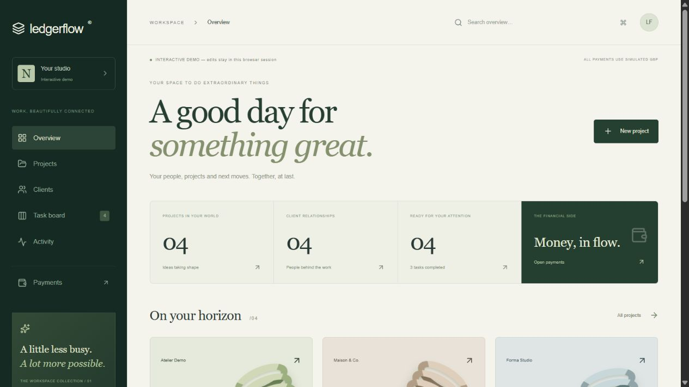
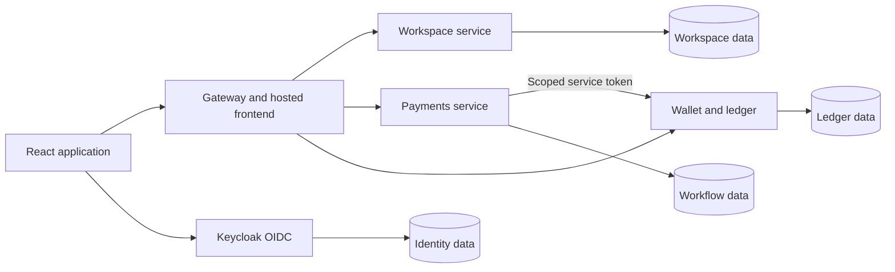

# LedgerFlow Studio

A business workspace for clients, proposals, projects and tasks, with a separate simulated-payment system. Built with React, TypeScript, Java 21 and Spring Boot.

Accounts and records are saved in PostgreSQL. Sample data is an optional development mode, disabled by default and in the hosted deployment. All payment funds are simulated GBP; no bank deposits or real-money payments are processed.



## Working features

| Area | Functionality |
| --- | --- |
| Accounts | Keycloak registration and login using OIDC authorization code with PKCE |
| Clients | Private company, contact and email records |
| Projects | Client-linked projects, briefs, target dates and progress |
| Tasks | Boards, status changes, project filters and completion tracking |
| Proposals | Priced deliverables, drafts, publication, feedback, acceptance and decline |
| Client portal | Verified recipients review proposals and follow deliverable progress |
| Project handoff | Acceptance creates one project and its starter tasks atomically; retries do not duplicate work |
| Activity | Latest workspace changes scoped to the signed-in account |
| Wallets | One simulated GBP wallet per account, test funding, balances and history |
| Transfers | Confirmation, asynchronous processing, idempotency and recovery |

The interface includes responsive layouts, animated details, reduced-motion support, accessible forms and error handling. Success is displayed after the backend confirms an action.

## How to use it

1. Choose **Sign in or create an account** and register a studio account.
2. Add a client in **Clients**, using the email of the person reviewing the proposal.
3. Create a proposal with a brief, target date and priced deliverables.
4. Review and publish it. Publishing makes it available in the portal; it does not send email.
5. The client signs in at `/portal` with the matching verified email. They can leave feedback, accept or decline.
6. Acceptance creates the linked project and starter tasks. The studio updates its task board and the portal shows deliverable progress. Later internal tasks stay private.
7. Open **Payments** to create a wallet, add simulated funds and transfer to another wallet ID.

Client email verification is enforced by the API. Without an email provider, an administrator can verify trusted test identities in Keycloak. Outbound verification email and notifications are not configured. Do not verify unknown identities without checking ownership of their email.

## Architecture



| Module | Responsibility | Local port | Status |
| --- | --- | --- | --- |
| workspace | Clients, projects, tasks, proposals and portal | 8086 | Implemented |
| wallet-ledger | Wallets, double-entry postings and freeze auditing | 8081 | Implemented core |
| payments | Transfer orchestration, idempotency and recovery | 8083 | Transfers implemented |
| gateway | Public routing, hosted frontend and runtime config | 8080 | Implemented |
| identity | Future application profiles and merchants | 8082 | Service shell |
| notifications | Future in-app/email delivery | 8084 | Service shell |
| reconciliation | Future consistency checks and findings | 8085 | Service shell |

Each protected API validates JWTs and checks ownership. Internal ledger writes require the payments client, ledger.post scope and ledger-internal audience. The gateway does not route internal posting endpoints.

Money uses integer minor units in storage and decimal strings in JSON. Transactions and consistent row locks prevent concurrent overspending. Entries are immutable and journals must balance. Quote totals use exact arithmetic too.

## Technology

React 19, TypeScript, Vite, TanStack Query, Motion, Tailwind CSS, Java 21, Spring Boot 3.5, Spring Cloud Gateway, JDBC, Flyway, PostgreSQL 17 and Keycloak 26.4. Verification uses Maven Wrapper, JUnit, Testcontainers, Vitest and GitHub Actions. Exact versions are pinned in the POM files and lockfile.

## Run locally

Prerequisites: Java 21, Node.js 24, Docker Desktop with Linux containers, and Git.

```powershell
git clone https://github.com/AashutoshR/ledgerflow.git
cd ledgerflow
Copy-Item infra/compose/.env.example infra/compose/.env
docker compose --env-file infra/compose/.env -f infra/compose/compose.yaml up -d
```

Replace the placeholder passwords before starting Compose. Keycloak runs at http://localhost:8180; its administrator password comes from the local environment file. Application users belong to realm ledgerflow.

For a pre-existing PostgreSQL volume, create missing databases without deleting data:

```powershell
docker compose --env-file infra/compose/.env -f infra/compose/compose.yaml exec postgres sh /opt/bootstrap/payments-db.sh
docker compose --env-file infra/compose/.env -f infra/compose/compose.yaml exec postgres sh /opt/bootstrap/workspace-db.sh
```

Start each Java service in a separate terminal. Set its environment variables to the corresponding values from your local environment file:

| Service | Required environment |
| --- | --- |
| workspace | WORKSPACE_DB_PASSWORD |
| wallet-ledger | DB_PASSWORD; TEST_FUNDING_ENABLED=true for simulated funding |
| payments | PAYMENTS_DB_PASSWORD; PAYMENTS_CLIENT_SECRET matching the payments-service client in Keycloak |
| gateway | Local defaults are sufficient |

Set the payments-service client secret in Keycloak's administration console before running payments.

```powershell
.\mvnw.cmd -pl services/workspace spring-boot:run
.\mvnw.cmd -pl services/wallet-ledger spring-boot:run
.\mvnw.cmd -pl services/payments spring-boot:run
.\mvnw.cmd -pl services/gateway spring-boot:run
```

Then start the frontend:

```powershell
cd web
npm ci
npm run dev
```

Open http://localhost:5173. Vite forwards /api to the gateway. Login and server persistence are the default. To explore the optional session-only demo locally, copy web/.env.example to web/.env.local, set VITE_DEMO_ENABLED=true and restart Vite. Render runtime configuration always disables the demo.

For an older realm missing email/profile scopes, run `python infra/compose/configure-portal-scopes.py` while Keycloak is running, then sign out and in.

## Deploy on Render

The [Render Blueprint](render.yaml) defines five **free** web services and one **free** PostgreSQL instance. The gateway also serves the frontend at the same origin. Workspace, ledger, payments and Keycloak run in separate containers.

Database schemas are separated inside the shared free instance. Render generates passwords and the internal client secret; they are not stored in Git. Browser and service traffic use HTTPS. Public frontend settings are loaded from /config.js at runtime. Verify the assigned service hostnames after creation and update host variables if Render assigns a different hostname. See [deployment details](docs/render.md).

Free-tier limits: services sleep after 15 idle minutes, cold starts can take about a minute, the workspace shares 750 free instance hours monthly, and the free database expires after 30 days. Free services cannot receive private-network traffic, so service endpoints use HTTPS and enforce authentication. [Render free-tier documentation](https://render.com/docs/free).

This is a live portfolio deployment with free-tier limitations. Shared credentials are a free-tier compromise. Production should use isolated databases/roles, reliable email verification, rate limits, monitoring, measured capacity and tested backups. Address database expiry before relying on long-term storage.

## Verify

```powershell
.\mvnw.cmd --batch-mode --no-transfer-progress verify
npm --prefix web ci
npm --prefix web run typecheck
npm --prefix web run test:ci
npm --prefix web run build
```

Backend integration tests require Docker. Coverage includes concurrent spending, transfer recovery, cross-user access, proposal acceptance races, feedback deduplication, portal privacy, exact amounts, migrations and real Keycloak claims. Gateway tests cover public SPA routes, safe runtime config and protected APIs. CI runs backend and frontend checks.

```powershell
docker build -t ledgerflow-workspace --build-arg SERVICE=workspace .
docker build -t ledgerflow-gateway -f infra/render/Dockerfile.gateway .
docker build -t ledgerflow-auth -f infra/render/Dockerfile.keycloak .
```

## Documentation

- [Workspace and proposal OpenAPI](contracts/openapi/workspace.json)
- [Wallet and ledger OpenAPI](contracts/openapi/wallet-ledger.json)
- [Proposals and portal](docs/proposals.md)
- [Workspace ownership](docs/workspace.md)
- [Transfer recovery](docs/transfers.md)
- [Original requirements](docs/requirements.md)
- [Status and limitations](docs/status.md)

## Remaining work

Merchant payments/refunds, event publishing, notifications, reconciliation, files, invoices, legal signatures and production operations remain unfinished. Outbox rows are written; broker delivery is pending. There are no measured performance or availability guarantees.

## Layout

```text
services/          Java services
web/               React application
contracts/         API specifications
infra/compose/     Local infrastructure
infra/render/      Hosted images and identity bootstrap
docs/              Requirements, workflows and verification
.github/workflows/ CI
render.yaml        Free-tier deployment
```
