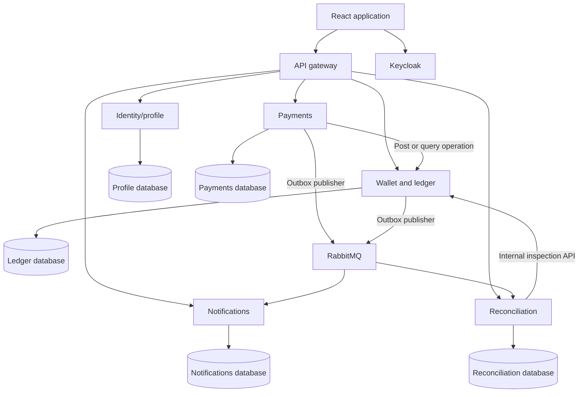

We’ll build a **microservices payment platform with simulated money**. It will support customer wallets, merchant payments, transfers, refunds, and an auditable ledger.

Below is the complete project specification, including technologies and the pipeline.

## 1. Technology stack

| Area | Technology | Purpose |
|---|---|---|
| Backend | **Java 21 + Spring Boot** | Business services and REST APIs |
| Build tool | **Maven Wrapper** | Reproducible builds |
| Database | **PostgreSQL** | Transactions, financial records, service data |
| Database access | **Spring JDBC** | Explicit SQL and transaction control |
| Migrations | **Flyway** | Versioned database changes |
| Messaging | **RabbitMQ** | Reliable asynchronous events |
| Authentication | **Keycloak + OpenID Connect** | Login, tokens, roles |
| Gateway | **Spring Cloud Gateway** | Routing, traffic limits, request IDs |
| Frontend | **React + TypeScript + Vite** | Customer, merchant, and administrator UI |
| UI styling | **Tailwind CSS** | Responsive interface |
| Frontend data | **TanStack Query** | API requests, caching, status refresh |
| API documentation | **OpenAPI** | Documented API contracts |
| Local environment | **Docker Compose** | Run services and dependencies locally |
| Backend testing | **JUnit, AssertJ, Testcontainers, WireMock** | Rules, integration, concurrency, failure tests |
| Frontend testing | **Vitest + Playwright** | Component logic and browser workflows |
| Load testing | **k6** | Throughput, latency, and contention |
| Observability | **OpenTelemetry, Prometheus, Grafana, Tempo, Loki** | Traces, metrics, dashboards, logs |
| CI/CD | **GitHub Actions** | Automated verification and releases |
| Container registry | **GitHub Container Registry** | Store application images |
| Security scanning | **CodeQL, Trivy, Dependabot** | Code, image, and dependency checks |
| Deployment, later | **Kubernetes + Helm** | Hosted service deployment |
| Infrastructure, later | **OpenTofu** | Repeatable cloud infrastructure |

We’ll pin exact compatible dependency versions during setup. Spring Cloud must match the chosen Spring Boot release. [Spring Boot compatibility documentation](https://docs.spring.io/spring-boot/system-requirements.html).

**Initial infrastructure stays manageable:** PostgreSQL, RabbitMQ, Keycloak, and Docker Compose. Kubernetes comes after the payment and recovery flows work.

## 2. Users and functionality

| Role | Required capabilities |
|---|---|
| Customer | Register, log in, create wallet, add test funds, transfer money, pay merchants, view history |
| Merchant | Register business profile, receive payments, view transactions, issue refunds |
| Administrator | Freeze wallets, inspect operations, review reconciliation findings, view audit history |

Release 1 supports **GBP only**.

Later releases can add multiple currencies, exchange rates, fees, payment limits, fraud rules, and external integrations.

## 3. Microservices

| Service | Responsibilities |
|---|---|
| **Identity/profile** | Application profiles, merchant registration, mapping users to Keycloak identities |
| **Wallet and ledger** | Wallets, accounts, authoritative balances, financial postings, freeze state |
| **Payments** | Merchant payments, transfers, refunds, idempotency, workflow recovery |
| **Notifications** | In-app notifications and simulated email delivery |
| **Reconciliation** | Detect financial inconsistencies and stalled workflows |
| **API gateway** | Route public requests and apply coarse traffic controls |

Each business service owns its database and credentials. Locally, separate databases can share one PostgreSQL server.

Services communicate through APIs and events. They cannot directly access another service’s tables.

## 4. Architecture



The **ledger is the source of truth for money**. Notifications and reporting cannot change financial outcomes.

## 5. Financial requirements

These are mandatory acceptance rules:

| Rule | Requirement |
|---|---|
| Double-entry accounting | Every journal has equal debits and credits within one currency |
| Exact amounts | Store integer minor units; £10.25 is `1025` |
| API precision | Represent amounts as decimal strings in JSON |
| No overdrafts | Concurrent requests cannot spend more than available funds |
| Atomic posting | Entries and balance changes commit together |
| Immutable records | Posted entries cannot be edited or deleted |
| Corrections | Use linked reversal entries |
| Safe retries | Retrying an operation cannot move money twice |
| Refund limits | Combined refunds cannot exceed the original payment |
| Traceability | Every movement links to its business operation |

The ledger will lock affected accounts in a consistent order before checking funds and posting changes. PostgreSQL provides the transaction controls, but we must implement and test the concurrency strategy. [PostgreSQL transaction documentation](https://www.postgresql.org/docs/current/transaction-iso.html).

## 6. Main workflows

**Merchant payment**

1. Customer submits a payment with an idempotency key.
2. Payments records the operation.
3. Ledger validates wallet status and funds.
4. Ledger posts the customer debit and merchant credit atomically.
5. Payments records the confirmed outcome.
6. Events trigger notifications and reconciliation.

**Payment lifecycle**

```text
CREATED → PROCESSING → SUCCEEDED
                     → FAILED
```

A timeout can leave an operation in `PROCESSING`. A recovery worker queries the ledger using the original operation reference.

**Refund**

- Merchant requests a full or partial refund.
- The system verifies ownership and the remaining refundable amount.
- Ledger serializes concurrent refund requests.
- Refund fails if merchant funds are insufficient in release 1.
- Successful refunds produce new entries linked to the original payment.

## 7. API requirements

Public endpoints use `/api/v1`.

| Endpoint | Purpose |
|---|---|
| `GET /me` | Current application profile |
| `POST /merchants` | Register merchant |
| `POST /wallets` | Create wallet |
| `GET /wallets/{id}/balance` | Read balance |
| `GET /wallets/{id}/transactions` | Paginated history |
| `POST /test/fundings` | Add simulated funds in test environments |
| `POST /transfers` | Transfer between wallets |
| `GET /transfers/{id}` | Transfer status |
| `POST /payments` | Pay merchant |
| `GET /payments/{id}` | Payment status |
| `POST /payments/{id}/refunds` | Request refund |
| `GET /notifications` | User notifications |
| `PUT /admin/wallets/{id}/freeze` | Freeze/unfreeze with reason |
| `POST /admin/reconciliation-runs` | Start reconciliation |

Financial writes require an `Idempotency-Key`.

- Same key and same request: return the existing operation.
- Same key with changed request: return `409 Conflict`.
- Pending operation: return `202 Accepted` and a status URL.
- Errors include a stable error code and request ID.
- All protected resources enforce ownership checks.
- Internal ledger posting endpoints are not publicly accessible.

## 8. Data requirements

| Service | Main tables |
|---|---|
| Identity/profile | `profiles`, `merchants` |
| Wallet/ledger | `wallets`, `ledger_accounts`, `posting_operations`, `journals`, `entries`, `account_balances`, `outbox` |
| Payments | `payments`, `transfers`, `refunds`, `idempotency_records`, `workflow_attempts`, `outbox` |
| Notifications | `notifications`, `delivery_attempts`, `inbox` |
| Reconciliation | `reconciliation_runs`, `findings`, `inbox` |

Use UTC timestamps, stable opaque identifiers, foreign keys within service boundaries, unique operation references, and versioned migrations.

## 9. Messaging and recovery

We’ll use the **transactional outbox pattern**:

1. Business changes and an outbox row commit together.
2. A worker publishes the event.
3. RabbitMQ confirms receipt.
4. The worker marks the row published.

Consumers record the event ID and local effects in one transaction before acknowledging the message.

RabbitMQ delivery can produce duplicates, so consumers must deduplicate. Publisher confirms and consumer acknowledgements cover different parts of delivery. [RabbitMQ reliability documentation](https://www.rabbitmq.com/docs/reliability).

Every event includes:

```text
event_id
event_type
schema_version
occurred_at
aggregate_id
aggregate_version
correlation_id
payload
```

Required recovery features:

- Bounded retries with backoff and jitter.
- Dead-letter queues.
- Audited message replay.
- Recovery of incomplete payment workflows.
- Detection of late or out-of-order events.
- Alerts for outbox backlog and stalled operations.

## 10. Security requirements

- Keycloak login using authorization code flow with PKCE.
- Customer, merchant, and administrator roles.
- Token validation in each API service.
- Resource ownership checks on every request.
- Scoped authentication for internal service calls.
- TLS in hosted environments.
- Least-privilege database and broker accounts.
- Secrets stored outside source control.
- No tokens, passwords, or sensitive payloads in logs.
- Rate limits on login and financial endpoints.
- Audited administrator actions.
- Administrator MFA for hosted environments.
- Simulated funding disabled outside designated test environments.

## 11. Frontend requirements

The UI must provide:

- Customer dashboard with balance and recent transactions.
- Payment and transfer forms.
- Confirmation before submitting money movements.
- Pending, successful, and failed transaction views.
- Merchant dashboard with refund controls.
- Administrator wallet inspection and reconciliation screens.
- Responsive layouts and keyboard-accessible forms.
- Clear validation and recovery messages.

The UI must show success only after the backend confirms it.

## 12. Testing requirements

| Test | Required result |
|---|---|
| Successful payment | Correct balances and balanced entries |
| Insufficient funds | No financial movement |
| Repeated request | One financial posting |
| Changed idempotent request | Conflict response |
| Concurrent spending | No overdraft |
| Concurrent refunds | Original payment limit preserved |
| Crash after ledger commit | Recovery without duplicate posting |
| Broker outage | Events delivered after recovery |
| Duplicate event | Consumer effects occur once |
| Freeze/payment race | Defined ordering is respected |
| Cross-user access | Request denied |
| Reconciliation fault | Inconsistency detected |
| Database migration | Clean and existing databases upgrade |
| Browser workflows | Customer payment and merchant refund succeed |

Use real PostgreSQL and RabbitMQ instances through Testcontainers for integration tests.

## 13. Operational targets

Initial targets must be measured on a documented environment:

- **50 financial operations/second** for 15 minutes.
- **p95 confirmed-operation latency below 1 second** with healthy dependencies.
- **Unexpected errors below 1%**, excluding deliberate business rejections.
- No duplicate posting or negative spendable balances.
- Pending operations recover within **60 seconds** after dependencies recover at reference load.

Hosted objectives, requiring later infrastructure work:

- 99.9% monthly API availability.
- Recovery point objective of 15 minutes.
- Recovery time objective of 60 minutes.
- Tested backups and restore procedures.

Dashboards should show payment latency, failure rate, pending operations, queue depth, outbox age, and reconciliation findings.

## 14. Project structure

```text
payment-platform/
├── .github/workflows/
├── services/
│   ├── identity/
│   ├── wallet-ledger/
│   ├── payments/
│   ├── notifications/
│   ├── reconciliation/
│   └── gateway/
├── web/
├── contracts/
│   ├── openapi/
│   └── events/
├── infra/
│   ├── compose/
│   ├── helm/
│   └── opentofu/
├── tests/
│   ├── e2e/
│   ├── load/
│   └── faults/
├── docs/
├── pom.xml
├── mvnw
└── mvnw.cmd
```

## 15. CI/CD pipeline

**Yes, a pipeline is necessary** because financial correctness must be checked on every change.

```mermaid
flowchart LR
    PR[Pull request] --> CHECK[Lint, types and static checks]
    CHECK --> TEST[Unit, integration and contract tests]
    TEST --> E2E[Financial and browser tests]
    E2E --> MERGE[Merge to main]
    MERGE --> BUILD[Build container images]
    BUILD --> SCAN[Scan images and generate SBOM]
    SCAN --> REG[Publish immutable images]
    REG --> STAGE[Deploy staging]
    STAGE --> SMOKE[Migration and smoke tests]
    SMOKE --> PROMOTE[Promote same images]
```



| Trigger | Pipeline actions |
|---|---|
| Pull request | Formatting, lint, types, unit/integration tests, contract checks, security checks |
| Merge to main | Required checks, container builds, image scans, SBOM, publish to GHCR |
| Staging release | Deploy exact image digests, run migrations, readiness checks, smoke tests |
| Production promotion | Promote the same tested digests under configured environment rules |
| Scheduled run | Dependency/security scans and longer load/failure tests |

Use backward-compatible database migrations. Application rollback must not assume a database migration can safely be reversed.

GitHub environments can control deployment access, and OIDC can avoid long-lived cloud credentials where supported. [GitHub environments](https://docs.github.com/en/actions/concepts/workflows-and-actions/deployment-environments), [GitHub OIDC](https://docs.github.com/en/actions/how-tos/secure-your-work/security-harden-deployments/oidc-in-cloud-providers).

### Starter CI workflow

This requires the project scaffold, Maven verification configuration, and frontend scripts. Action release tags shown below should be replaced with reviewed commit SHAs when installed.

```yaml
name: CI

on:
  pull_request:
  push:
    branches: [main]
  workflow_dispatch:

permissions:
  contents: read

concurrency:
  group: ci-${{ github.workflow }}-${{ github.ref }}
  cancel-in-progress: true

jobs:
  backend:
    name: Backend verification
    runs-on: ubuntu-latest
    timeout-minutes: 25

    steps:
      - uses: actions/checkout@v4

      - uses: actions/setup-java@v4
        with:
          distribution: temurin
          java-version: "21"
          cache: maven

      - name: Run unit and integration tests
        run: bash ./mvnw --batch-mode --no-transfer-progress verify

      - name: Upload test reports
        if: always()
        uses: actions/upload-artifact@v4
        with:
          name: backend-test-reports
          path: |
            **/target/surefire-reports/**
            **/target/failsafe-reports/**
          retention-days: 7

  frontend:
    name: Frontend verification
    runs-on: ubuntu-latest
    timeout-minutes: 15

    defaults:
      run:
        working-directory: web

    steps:
      - uses: actions/checkout@v4

      - uses: actions/setup-node@v4
        with:
          node-version: "22"
          cache: npm
          cache-dependency-path: web/package-lock.json

      - run: npm ci
      - run: npm run lint
      - run: npm run typecheck
      - run: npm run test:ci
      - run: npm run build
```

Container publishing and deployment jobs will be implemented once Dockerfiles, Helm charts, and a hosting target exist.

## 16. Implementation milestones

| Milestone | Completion gate |
|---|---|
| 1. Foundation | Repository, services, local dependencies, authentication, passing CI |
| 2. Financial core | Wallets, ledger, funding, transfers, concurrency tests |
| 3. Payments | Merchant payments, idempotency, crash recovery |
| 4. Messaging | Outbox, notifications, retries, dead-letter replay |
| 5. Product | Refunds, administration, reconciliation, complete web flows |
| 6. Operations | Tracing, dashboards, load tests, backups, recovery drills |
| 7. Deployment | Staging pipeline, image promotion, rollback validation |

**The first development task is the foundation, followed by the ledger: two wallets, simulated funding, one transfer, and tests proving that retries and concurrent requests cannot corrupt balances.**