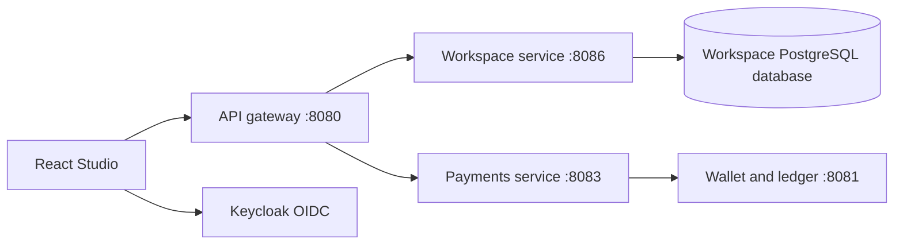

# LedgerFlow Studio

The application now includes a private business workspace alongside simulated payments. This extends the original payment requirements at the user's request; it does not replace the financial correctness requirements.

## What works

- Create client contacts with a company, contact name and email.
- Create projects linked to a client, with a brief and target date.
- Create tasks under a project and move them through To do, In progress and Completed.
- Filter the board by project; search clients, projects, tasks and activity.
- Compute project progress from completed tasks.
- Review the latest 40 workspace activity records.
- Navigate to the existing wallet/transfer application at `/payments`.

`/workspace` opens Studio. Without authentication it is an interactive demo: sample records and edits are kept in sessionStorage, isolated from authenticated records. Refreshing the same browser tab retains demo edits; closing the browser session can discard them. Demo contacts use reserved example.test addresses. Signing in does not import demo data. An authenticated API error displays an error rather than sample records.

## Service boundary

Clients, projects and tasks form one work-management domain. They share the workspace database, with owner-scoped foreign keys. This service has no access to ledger tables and cannot move money. Activity records commit in the same transaction as workspace changes. They are local activity records, not RabbitMQ notifications. No cross-service project billing or invoices are implemented yet.

Every endpoint requires a validated JWT. The JWT subject is the owner; clients cannot choose an owner in a request. Cross-owner references and task edits return 404. Create requests carry a stable UUID generated before submission. Repeating an identical creation returns the existing record without another activity entry; reusing its UUID with different content returns 409. Task changes use a version field; concurrent changes cannot silently overwrite one another. After 409, refresh before submitting a new task change. Each browser demo and authenticated account is separate; shared team membership is not implemented.

## Local startup

1. Add `WORKSPACE_DB_PASSWORD` to `infra/compose/.env`, alongside the existing values.
2. From `infra/compose`, run `docker compose up -d`. On a fresh volume the workspace database is created automatically. On an existing PostgreSQL volume run `docker compose exec postgres sh /opt/bootstrap/workspace-db.sh`. This creates the missing role/database without removing existing data. It does not rotate an existing role's password.
3. In a terminal with Java 21, set `WORKSPACE_DB_PASSWORD` to the same value and run `./mvnw.cmd -pl services/workspace spring-boot:run` from the repository root.
4. Run the gateway separately: `./mvnw.cmd -pl services/gateway spring-boot:run`.
5. Run `npm run dev` in `web`, open http://localhost:5173/workspace and sign in through the existing Keycloak realm. The gateway routes `/api/v1/workspace/**` to port 8086. Payment services are separately required for Payments.

API contract: `contracts/openapi/workspace.json`.

## Verification and limits

PostgreSQL Testcontainers tests cover isolated ownership, cross-owner references, repeat creation, transactional activity deduplication, concurrent task moves, authentication, validation, API date serialization and cross-user task mutation. Frontend tests cover progress/search and the shared API client (PATCH empty responses, error status and transfer idempotency headers). Browser verification covers demo client → project → task → completion, activity search and persistence after refresh, plus desktop and 390px layouts.

Live Keycloak-to-browser end-to-end verification is still pending. Workspace snapshots currently load the owner's full collection, so server pagination is required before large datasets. Editing/archiving clients and projects, task assignments, shared teams, files, calendar scheduling, invoices and cross-service events are future increments. Merchant payments/refunds, notification delivery, reconciliation, operational hardening and deployment remain outstanding in the wider platform.

## Proposals and client collaboration

The workspace service now also owns proposals and client conversations. See [proposal workflow and portal access](proposals.md). Studio has Proposals and Client portal navigation; `/portal` opens the portal directly.
